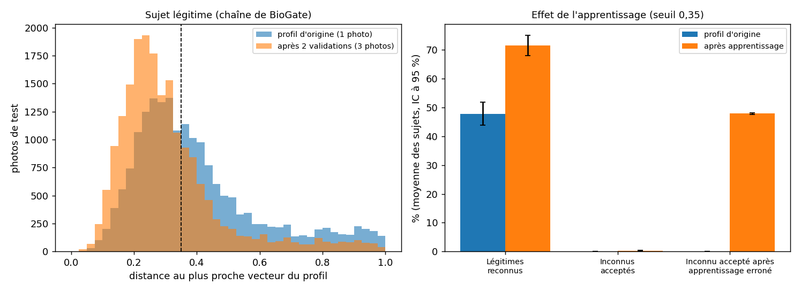

# Apprentissage continu sur de nombreux sujets (LFW)

*Généré par `tests/mesures/mesure_apprentissage_lfw.py` le 02/11/2026 à 01:58.*

## Protocole

- Base LFW (Labeled Faces in the Wild, version « funneled »). **150 sujets** tirés au hasard (graine 1) parmi les 217 personnes qui ont au moins 8 photos ; au plus 10 photos par sujet, soit **1429 images**. Les sujets sont numérotés : aucun nom n'est publié.
- Pour chaque sujet, comme BioGate : **enrôlement** avec une photo ; **apprentissage validé** : deux autres photos sont ajoutées au profil (ce que ferait une confirmation par empreinte) ; **test** sur toutes les autres photos du sujet (jamais vues du profil). La répartition est **tirée au hasard 20 fois par sujet** : aucun résultat ne dépend d'un ordre de photos ; chaque sujet est résumé par la moyenne de ses répétitions.
- Une photo est reconnue si la distance cosinus au plus proche vecteur du profil est sous **0,35**. Les **fausses acceptations** se comptent sur les photos de **toutes** les autres personnes du jeu (aucun échantillonnage).
- **Unité statistique : le sujet** (les photos d'un même sujet ne sont pas indépendantes). Moyennes sur les sujets, **intervalles de confiance à 95 %** par rééchantillonnage des sujets (5000 tirages), test appairé de **Wilcoxon** sur les sujets.
- **Apprentissage erroné, exhaustif** : pour chaque couple (sujet, inconnu), une photo de l'inconnu est ajoutée au profil du sujet comme si l'empreinte l'avait confirmée à tort ; on mesure la part des autres photos de cet inconnu acceptées.
- Chaîne de BioGate appliquée telle quelle (Haar, CLAHE, FaceNet512 avec alignement). Écart maximal avec le code de production (`FaceRecognizer._extract_face_signature`) sur 6 images : **1.2e-07** en distance cosinus (nul à la précision numérique près).

## Résultats pour la chaîne de BioGate (seuil 0,35)

Moyenne des sujets, avec l'intervalle de confiance à 95 % entre crochets.

| Indicateur | Profil d'origine (1 photo) | Après 2 validations (3 photos) | Différence |
|---|---|---|---|
| Photos de test du sujet reconnues | 47,8 % [43,8 ; 51,8] | 71,6 % [68,0 ; 75,2] | +23,8 points [22,3 ; 25,4], Wilcoxon p = 7,1e-26 |
| Distance moyenne des photos de test | 0,427 | 0,316 | -0,111 |
| Photos d'inconnus acceptées à tort (fausses acceptations) | 0,1 % [0,1 ; 0,1] | 0,3 % [0,2 ; 0,3] | +0,18 points [0,14 ; 0,22], Wilcoxon p = 2,0e-22 |
| **Après un apprentissage erroné** : autres photos de l'inconnu acceptées | 0,1 % [0,1 ; 0,1] | 47,9 % [47,6 ; 48,2] | dans 50,7 % [50,3 ; 51,2] des cas, plus de la moitié de ses photos sont acceptées |

- Effet sur la reconnaissance : **147 sujets améliorés, 3 inchangés** sur 150 (le minimum sur davantage de vecteurs ne peut que baisser la distance : l'amélioration est attendue, ce qui est mesuré ici est son **ampleur** et son **coût en fausses acceptations**).
- Lecture (d'après les chiffres ci-dessus) : l'apprentissage validé relève la reconnaissance de 23,8 points ; les fausses acceptations passent de 0,1 % [0,1 ; 0,1] à 0,3 % [0,2 ; 0,3] (variation significative au seuil de 5 %). Un seul apprentissage erroné fait passer, pour l'inconnu concerné, la part de ses photos acceptées de 0,1 % [0,1 ; 0,1] à 47,9 % [47,6 ; 48,2], contre 0,3 % [0,2 ; 0,3] pour un inconnu quelconque après un apprentissage valide : c'est ce que la confirmation par un facteur fort (l'empreinte) avant tout ajout au profil évite.

## Sensibilité des résultats

- **Quasi-doublons** : en moyenne 1,7 % [0,8 ; 2,8] des photos de test sont à moins de 0,1 d'une photo du profil (prises à la même occasion). En les écartant pour les deux profils, la reconnaissance passe de 47,4 % [43,5 ; 51,5] à 71,2 % [67,7 ; 74,8].

| Seuil | Reconnues, origine | Reconnues, après | Fausses acceptations, origine | Fausses acceptations, après |
|---|---|---|---|---|
| 0,3 | 35,2 % [31,4 ; 39,1] | 58,1 % [53,7 ; 62,4] | 0,0 % [0,0 ; 0,0] | 0,1 % [0,1 ; 0,1] |
| 0,35 | 47,8 % [43,8 ; 51,8] | 71,6 % [68,0 ; 75,2] | 0,1 % [0,1 ; 0,1] | 0,3 % [0,2 ; 0,3] |
| 0,4 | 58,9 % [55,0 ; 62,8] | 80,8 % [78,0 ; 83,5] | 0,2 % [0,2 ; 0,3] | 0,6 % [0,5 ; 0,7] |

- **Sans seuil** (toutes les paires du jeu : 6138 paires d'une même personne, 1014168 de personnes différentes) : aire sous la courbe ROC **0,919**, point d'égal taux d'erreur **14,1 %** au seuil 0,71.

## Les trois variantes de la chaîne (mêmes sujets, mêmes photos)

| Variante | Aire ROC | Égal taux d'erreur (seuil) | FRR / FAR des paires à 0,35 | Distance moyenne : même personne / personnes différentes | Reconnues, origine → après |
|---|---|---|---|---|---|
| Chaîne de BioGate (Haar, CLAHE, FaceNet512) | 0,919 | 14,1 % (0,71) | 51,4 % / 0,1 % | 0,427 / 0,899 | 47,8 % → 71,6 % |
| Image entière, sans Haar ni CLAHE (FaceNet512 seul) | 0,921 | 14,1 % (0,74) | 42,9 % / 0,1 % | 0,404 / 0,924 | 56,4 % → 79,0 % |
| Haar sans CLAHE (FaceNet512) | 0,924 | 13,5 % (0,73) | 43,7 % / 0,1 % | 0,402 / 0,922 | 55,8 % → 79,5 % |

Haar a trouvé un visage dans 1416 images sur 1429 (chaîne de BioGate).

## Menaces à la validité et réponses

| Objection possible | Réponse |
|---|---|
| « Un seul tirage de photos peut être favorable. » | La répartition enrôlement / apprentissage / test est tirée 20 fois par sujet ; les résultats sont des moyennes. |
| « Les photos d'un même sujet ne sont pas indépendantes. » | L'unité statistique est le sujet : intervalles de confiance et test par rééchantillonnage ou appariement des sujets, jamais des photos. |
| « Des photos presque identiques gonflent l'effet. » | Résultats redonnés en écartant toute photo de test proche d'une photo du profil. |
| « Le seuil a été choisi pour que ça marche. » | Le seuil de 0,35 vient de la webcam, pas de ce jeu ; résultats donnés à 0,30, 0,35 et 0,40, et sans seuil (aire ROC, égal taux d'erreur). |
| « Les sujets ont été choisis. » | Tirage au hasard avec graine fixée parmi toutes les personnes éligibles ; aucun nom publié ; le script reproduit tout. |
| « Votre chaîne de mesure n'est pas celle du produit. » | Comparée au code de production sur des images réelles : écart nul à la précision numérique près. |
| « L'amélioration est automatique : plus de vecteurs, plus de chances. » | Oui, et c'est le comportement de BioGate : la question mesurée est l'ampleur du gain et le coût en fausses acceptations, avec l'apprentissage erroné comme contre-exemple. |
| « La confirmation par empreinte n'est pas parfaite. » | Elle est supposée fiable (empreinte simulée dans le prototype) : la mesure d'apprentissage erroné chiffre ce qui arrive si elle ne l'est pas. |

## Limites

- LFW ne date pas les photos : ce sont des photos de presse prises dans des conditions variées (pose, lumière, expression, quelques années d'écart au plus). Elles couvrent la variabilité naturelle d'un visage, **pas le vieillissement sur dix ans**, ni la pousse d'une barbe : pour cela, l'essai à trois photos datées (Chris Evans, 0,4722 → 0,224) reste la démonstration.
- Les personnes de LFW sont des personnalités très photographiées : le jeu n'est pas représentatif de toute la population (âge, origine, genre), et les taux absolus ne se transposent pas tels quels à une caméra de porte.
- BioGate compare à plusieurs photos enrôlées à la webcam, avec une caméra fixe : son FRR réel n'est pas celui de cette mesure.
- Un seul jeu de sujets (graine fixée). Les répétitions couvrent la répartition des photos, pas le choix des sujets ; l'intervalle de confiance couvre ce dernier.
- L'apprentissage erroné est simulé avec une photo d'inconnu tirée au hasard ; le risque est plus fort pour deux visages qui se ressemblent.

## Matériel et versions

- Système : Windows-10-10.0.26200-SP0
- Processeur : AMD Ryzen 5 220 w/ Radeon 740M Graphics
- Cœurs logiques : 12
- Mémoire : 15,3 Go
- Python : 3.11.15
- TensorFlow : 2.21.0
- DeepFace : 0.0.99
- OpenCV : 4.11.0
- Durée du calcul des embeddings et des expériences : 1087 s
