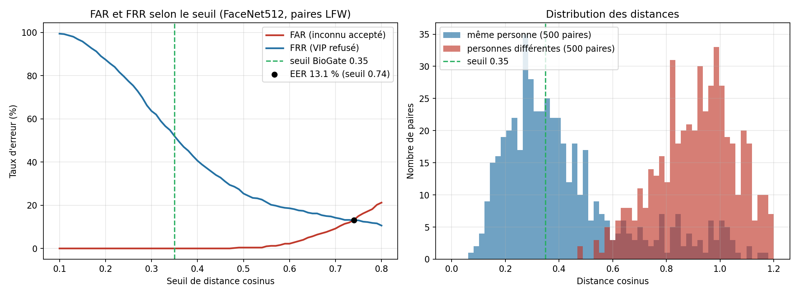

# Mesure du FAR et du FRR de FaceNet512 sur LFW

*Généré par `tests/mesures/mesure_far_frr.py` le 01/11/2026 à 22:58.*

## Protocole

- Base : LFW (Labeled Faces in the Wild), version « funneled », fichier de paires `pairsDevTest.txt` : **500 paires de la même personne** et **500 paires de personnes différentes** (1549 images uniques).
- Chaîne identique à celle de BioGate : détection Haar du visage, CLAHE (canal L), `DeepFace.represent` (Facenet512, `align=True`, détecteur `opencv`), distance cosinus.
- Haar a trouvé un visage dans 1527 images ; sur 22 images il n'en a pas trouvé et l'image entière a été utilisée ; 0 illisibles.
- FAR = part des paires de personnes différentes dont la distance est **sous** le seuil (un inconnu serait accepté). FRR = part des paires de la même personne dont la distance est **au-dessus** du seuil (un VIP serait refusé).

## Résultats

- Seuil de BioGate : **0.35** → FAR **0.0 %**, FRR **52.0 %**.
- Point d'égal taux d'erreur (EER) : **13.1 %** au seuil **0.74**.
- Aire sous la courbe ROC (probabilité qu'une paire identique soit plus proche qu'une paire différente) : **0.931**.
- Distance moyenne : même personne **0.424** (écart-type 0.237), personnes différentes **0.923** (écart-type 0.159).

| Seuil | FAR (%) | FRR (%) |
|---|---|---|
| 0.20 | 0.0 | 87.4 |
| 0.25 | 0.0 | 77.4 |
| 0.30 | 0.0 | 63.6 |
| 0.35 ← BioGate | 0.0 | 52.0 |
| 0.40 | 0.0 | 40.6 |
| 0.45 | 0.0 | 32.8 |
| 0.50 | 0.4 | 25.4 |
| 0.60 | 2.2 | 18.6 |

## Matériel et versions

- Système : Windows-10-10.0.26200-SP0
- Processeur : AMD Ryzen 5 220 w/ Radeon 740M Graphics
- Cœurs logiques : 12
- Mémoire : 15,3 Go
- Python : 3.11.15
- TensorFlow : 2.21.0
- DeepFace : 0.0.99
- OpenCV : 4.11.0

Temps de calcul des embeddings : 635 s pour 1549 images (0.41 s par image, Haar + CLAHE + FaceNet512 sur processeur).

## Limites

- LFW contient des photos de personnalités prises dans des conditions variées, pas des visages devant une caméra de porte ; les chiffres donnent un ordre de grandeur et justifient le choix du seuil, pas une garantie en conditions réelles.
- Une seule série de 1 000 paires ; pas de validation croisée sur les 10 séries de LFW.
- BioGate compare à plusieurs échantillons par personne (le plus proche gagne) : son FRR réel est plus bas que celui de cette mesure à un seul échantillon, son FAR un peu plus haut.
