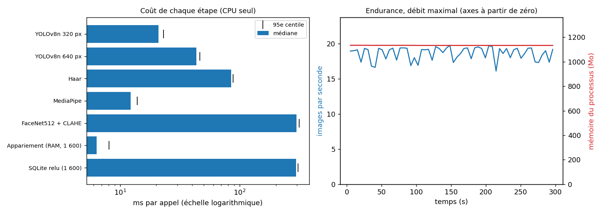

# Performance du pipeline de BioGate

*Généré par `tests/mesures/mesure_performance.py` le 02/11/2026 à 05:02.*

## Protocole

- Les **vraies fonctions du serveur** sont appelées (`api._run_pipeline_and_annotate`, `YoloDetector`, `FaceRecognizer`), sur CPU seul, sans autre charge (serveur et tableau de bord arrêtés). Base SQLite et dossier de photos **temporaires** : la vraie base n'est ni lue ni modifiée ; aucune alerte n'est envoyée ; second facteur désactivé.
- **Scène** : une photo (images libres de droits des tests d'apprentissage) collée sur un fond noir de 640 × 480, donc reproductible. Un résident est enrôlé avec la photo de 2019 ; la photo de 2024 est reconnue (résident), celle de 2014 ne l'est pas (inconnu).
- Les 5 premiers appels de chaque mesure sont écartés (échauffement). Chaque valeur est donnée en **médiane**, **95e centile** et moyenne ± écart-type. YOLO à 320 et à 640 pixels est mesuré en **alternant** les deux réglages image par image, pour annuler la dérive de la machine.
- Nombre de mesures par étape : 100 ; régime stable : 40 s ; débit maximal : 60 s ; endurance : 300 s.

## Ce qu'il faut retenir

- **Identification d'une personne** (première image) : 401 ms (médiane), soit environ 2,5 image par seconde ; FaceNet512 en représente 74 %.
- **Régime stable** (personne déjà identifiée) : médiane de 30 ms par image, 95e centile de 430 ms (les revérifications), et un débit d'analyse maximal de 18,3 images par seconde.
- **Réglage de YOLO à 320 pixels** : 21 ms contre 43 ms à 640 pixels, soit 2,1 fois moins.
- **Cache en mémoire** : à 1 600 vecteurs, 6,4 ms contre 295 ms pour relire SQLite à chaque image, soit 46 fois moins.
- **Décision pour un résident** : 0,45 s de la première image à « accès accordé » (médiane).

## 1. Coût de chaque étape

| Étape | Médiane (ms) | 95e centile (ms) | Moyenne ± écart-type (ms) | Mesures | Remarque |
|---|---|---|---|---|---|
| Détection des personnes, YOLOv8n à 320 px (réglage de BioGate) | 20,99 | 23,09 | 21,00 ± 1,29 | 100 |  |
| Détection des personnes, YOLOv8n à 640 px | 43,28 | 46,42 | 43,40 ± 1,80 | 100 | pour comparaison |
| NMS maison (6 boîtes qui se recouvrent) | 0,01 | 0,01 | 0,01 ± 0,00 | 1 | moyenne sur 5 000 appels |
| Face Gate : détecteur de Haar (silhouette) | 84,38 | 88,17 | 84,78 ± 2,06 | 100 |  |
| Face Gate : second avis MediaPipe | 12,23 | 13,87 | 12,36 ± 0,81 | 100 |  |
| Correction de contraste CLAHE seule | 0,82 | 1,36 | 0,91 ± 0,21 | 100 |  |
| Embedding FaceNet512 (CLAHE incluse) | 297,83 | 312,91 | 300,60 ± 20,47 | 100 | l'étape la plus coûteuse, lancée seulement si un visage de face est confirmé |
| Appariement, cache en mémoire, 16 vecteurs | 0,06 | 0,09 | 0,06 ± 0,01 | 195 |  |
| Relecture de SQLite à chaque image, 16 vecteurs | 3,10 | 4,55 | 3,51 ± 0,66 | 10 | ce que le cache en mémoire évite |
| Appariement, cache en mémoire, 160 vecteurs | 0,58 | 1,04 | 0,65 ± 0,22 | 195 |  |
| Relecture de SQLite à chaque image, 160 vecteurs | 32,27 | 38,69 | 32,29 ± 3,65 | 10 | ce que le cache en mémoire évite |
| Appariement, cache en mémoire, 1600 vecteurs | 6,37 | 8,05 | 6,72 ± 0,88 | 195 |  |
| Relecture de SQLite à chaque image, 1600 vecteurs | 294,70 | 306,44 | 294,84 ± 7,24 | 10 | ce que le cache en mémoire évite |
| Appariement, cache en mémoire, 16000 vecteurs | 69,01 | 72,67 | 69,02 ± 2,04 | 15 |  |
| Relecture de SQLite à chaque image, 16000 vecteurs | 3082,87 | 3308,38 | 3128,53 ± 152,13 | 3 | ce que le cache en mémoire évite |

Lecture : chaque ligne est un coût **par appel**. Le cache en mémoire évite de relire et de décoder les vecteurs dans SQLite à chaque image ; l'écart croît avec le nombre de vecteurs.

## 2. Régimes de fonctionnement (pipeline complet)

| Régime | Médiane (ms) | 95e centile (ms) | Moyenne ± écart-type (ms) | Images par seconde (1 / moyenne) | Mesures | Remarque |
|---|---|---|---|---|---|---|
| Première image d'un inconnu (identification) | 401 | 415 | 407 ± 26 | 2,5 | 20 | YOLO + suivi + Haar + MediaPipe + FaceNet |
| Première image d'un résident (identification) | 443 | 456 | 446 ± 8 | 2,2 | 20 | même chaîne, appariement réussi |
| Régime stable, résident identifié, images à 5 par seconde | 30 | 430 | 159 ± 185 | 6,3 | 147 | état GRANTED ; revérification toutes les 0,8 s ; cadence imposée de 5 images par seconde |
| Débit maximal, résident identifié, sans pause | 27 | 419 | 55 ± 101 | 18,3 | 1100 | images par seconde = débit d'analyse du serveur |

## 3. Temps de décision (images à 5 par seconde)

| Décision | Médiane (s) | 95e centile (s) | Moyenne (s) | Essais réussis |
|---|---|---|---|---|
| Résident : de la première image à « accès accordé » | 0,45 | 0,50 | 0,46 | 10 sur 10 |
| Inconnu : de la première image à « intrus provisoire » | 1,64 | 1,68 | 1,65 | 10 sur 10 |

Le temps d'un inconnu comprend la fenêtre d'analyse du réglage (`FACE_ANALYSIS_TIME_LIMIT`, 1 s par défaut) : c'est un délai voulu, pas un coût de calcul.

## 4. Endurance

- Débit maximal pendant 300 s : **18,42 images par seconde** au début (premier cinquième) et **18,47** à la fin (dernier cinquième).
- Processeur : 609 % d'un cœur en moyenne pour le processus, soit **51 % de la machine** (12 cœurs logiques).
- Mémoire du processus : 1135 Mo au départ, 1133 Mo à la fin, maximum 1135 Mo (**variation de -1 Mo**).

## Limites

- La scène est une photo fixe sur fond noir : elle isole le coût du pipeline, pas celui d'une scène réelle (plusieurs personnes, mouvement, arrière-plan chargé). Le débit réel du flux de la caméra BW21 (17 à 30 images par seconde en 640 × 480) a été relevé à part et ne dépend pas de ce pipeline.
- Le débit d'analyse du serveur est volontairement inférieur à celui de la caméra : les images en trop sont abandonnées (file de quatre places) et l'affichage est dessiné à la cadence de la caméra.
- Une seule machine (voir ci-dessous), un seul processeur, CPU seul : aucun résultat sur Raspberry Pi, qui reste une perspective.
- Les mesures dépendent de la charge de la machine au moment de l'essai ; le protocole (échauffement, alternance, médiane et 95e centile) limite ce biais sans le supprimer.

## Matériel et versions

- Système : Windows-10-10.0.26200-SP0
- Processeur : AMD Ryzen 5 220 w/ Radeon 740M Graphics
- Cœurs logiques : 12
- Mémoire : 15,3 Go
- Python : 3.11.15
- TensorFlow : 2.21.0
- DeepFace : 0.0.99
- OpenCV : 4.11.0
- Durée totale de la mesure : 542 s
