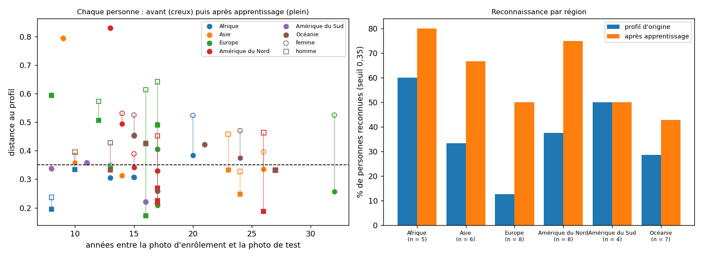

# Apprentissage continu face au vieillissement, sur des personnes de tous les continents

*Généré par `tests/mesures/mesure_vieillissement_commons.py` le 04/11/2026 à 03:52.*

## Protocole

- Même protocole que l'essai Chris Evans, répété sur **38 personnes** : photo la plus **ancienne** = enrôlement ; photo **intermédiaire** = apprentissage validé (ce que ferait une confirmation par empreinte) ; photo la plus **récente** = test, au moins 8 ans après l'enrôlement. Distance cosinus de la chaîne de BioGate (Haar, CLAHE, FaceNet512), reconnue sous **0,35**.
- **Sélection fixée avant tout résultat** : liste de candidats (`candidats_vieillissement.csv`) ordonnée par case (6 régions × 2 sexes) puis par prénom ; les 4 premiers candidats de chaque case qui satisfont tous les critères sont retenus, sans aucun choix à la main.
- **Photos** : Wikimedia Commons, licence libre (CC BY, CC BY-SA, CC0, domaine public), date de prise de vue dans les métadonnées, largeur d'au moins 400 px, **nom de la personne dans le nom du fichier** (c'est le sujet de la photo), un seul visage de face d'au moins 70 px (Haar de BioGate confirmé par MediaPipe). Vérification d'identité : une distance supérieure à 0,90 entre deux des trois photos (typique de deux personnes différentes) fait écarter le candidat.
- Sexe et région (continent de nationalité) viennent des biographies publiques ; ils servent seulement à répartir l'évaluation. Les images ne sont pas copiées dans le dépôt : `manifeste_photos.csv` donne les pages Commons, auteurs, licences et années.

## Résultats globaux

- Personnes reconnues avec le **profil d'origine** (une photo, souvent ancienne) : **13 sur 38 (34,2 % [21,2 ; 50,1])**.
- Après **apprentissage** d'une photo intermédiaire : **23 sur 38 (60,5 % [44,7 ; 74,4])**. 10 personnes passent de « non reconnue » à « reconnue » (test exact de McNemar : p = 0,0020, aucune personne ne se dégrade : le minimum sur davantage de vecteurs ne peut qu'améliorer).
- Distance moyenne au profil : **0,430** [0,388 ; 0,478] avant, **0,361** [0,319 ; 0,410] après ; baisse moyenne 0,069 [0,039 ; 0,104] (intervalles de confiance à 95 % par rééchantillonnage des personnes).
- **Effet des années** : la distance entre la photo d'enrôlement et la photo de test augmente avec l'écart d'années (Spearman ρ = -0,02, p = 0,925 ; pente de -0,015 par décennie).
- **Fausses acceptations** : photos de test d'autres personnes du jeu acceptées par un profil : 2 sur 1406 avant, 5 sur 1406 après apprentissage.

## Par région et par sexe (descriptif)

| Région | Personnes | Reconnues, profil d'origine | Reconnues, après apprentissage | Distance moyenne avant → après | Écart moyen (années) |
|---|---|---|---|---|---|
| Afrique | 5 | 3 sur 5 (60,0 % [23,1 ; 88,2]) | 4 sur 5 (80,0 % [37,6 ; 96,4]) | 0,353 → 0,305 | 13,2 |
| Asie | 6 | 2 sur 6 (33,3 % [9,7 ; 70,0]) | 4 sur 6 (66,7 % [30,0 ; 90,3]) | 0,447 → 0,397 | 17,7 |
| Europe | 8 | 1 sur 8 (12,5 % [2,2 ; 47,1]) | 4 sur 8 (50,0 % [21,5 ; 78,5]) | 0,524 → 0,372 | 16,5 |
| Amérique du Nord | 8 | 3 sur 8 (37,5 % [13,7 ; 69,4]) | 6 sur 8 (75,0 % [40,9 ; 92,9]) | 0,435 → 0,361 | 17,0 |
| Amérique du Sud | 4 | 2 sur 4 (50,0 % [15,0 ; 85,0]) | 2 sur 4 (50,0 % [15,0 ; 85,0]) | 0,342 → 0,342 | 12,5 |
| Océanie | 7 | 2 sur 7 (28,6 % [8,2 ; 64,1]) | 3 sur 7 (42,9 % [15,8 ; 75,0]) | 0,408 → 0,371 | 19,0 |

| Sexe | Personnes | Reconnues, profil d'origine | Reconnues, après apprentissage | Distance moyenne avant → après | Écart moyen (années) |
|---|---|---|---|---|---|
| F | 23 | 8 sur 23 (34,8 % [18,8 ; 55,1]) | 12 sur 23 (52,2 % [33,0 ; 70,8]) | 0,432 → 0,386 | 16,2 |
| M | 15 | 5 sur 15 (33,3 % [15,2 ; 58,3]) | 11 sur 15 (73,3 % [48,0 ; 89,1]) | 0,428 → 0,324 | 16,7 |

Les effectifs par groupe sont petits : les intervalles (Wilson, 95 %) sont larges et **ces lignes décrivent l'échantillon, elles ne prouvent aucune différence entre groupes**. Pour une étude des écarts selon l'origine, le rapport 8280 du NIST (Grother et coll., 2019) porte sur des millions d'images ; il est cité au chapitre 1.

## Le filtre de visage de BioGate (Haar + MediaPipe) selon la région et le sexe (descriptif)

Pour chaque photo admissible testée (licence, date, taille, nom dans le fichier), motif du rejet ou validation par le filtre de visage de BioGate. « Plusieurs visages » et « aucun visage » dépendent aussi du type de photo (événement, groupe, pose) : **ce tableau décrit l'échantillon, il ne prouve pas un biais du détecteur**.

| Région | Photos testées | Aucun visage de face | Plusieurs visages | Un visage non confirmé par MediaPipe | **Un visage de face validé** |
|---|---|---|---|---|---|
| Afrique | 250 | 42,4 % | 20,0 % | 12,8 % | **24,8 %** [19,9 ; 30,5] |
| Asie | 258 | 13,6 % | 41,1 % | 13,6 % | **31,8 %** [26,4 ; 37,7] |
| Europe | 331 | 23,3 % | 25,4 % | 10,9 % | **40,5 %** [35,3 ; 45,9] |
| Amérique du Nord | 408 | 30,6 % | 28,2 % | 11,5 % | **29,7 %** [25,4 ; 34,3] |
| Amérique du Sud | 397 | 35,8 % | 28,5 % | 18,4 % | **17,4 %** [14,0 ; 21,4] |
| Océanie | 336 | 21,1 % | 31,5 % | 13,1 % | **34,2 %** [29,4 ; 39,5] |

| Sexe | Photos testées | Aucun visage de face | Plusieurs visages | Un visage non confirmé par MediaPipe | **Un visage de face validé** |
|---|---|---|---|---|---|
| F | 982 | 23,9 % | 29,3 % | 11,8 % | **34,9 %** [32,0 ; 38,0] |
| M | 998 | 32,2 % | 28,7 % | 15,1 % | **24,0 %** [21,5 ; 26,8] |

## Candidats examinés

- 90 candidats examinés, **38 retenus**. Motifs d'écart : 25 × moins de 3 photos valides; 14 × écart d'années ou photo intermédiaire insuffisant; 13 × identité douteuse.
- Détail dans `candidats_journal.csv`.

## Limites

- Les personnes sont des **célébrités très photographiées** : photos de presse ou d'événements, plus soignées qu'une caméra de porte, et retouchées parfois ; les taux absolus ne se transposent pas tels quels à BioGate.
- La sélection exige un seul visage de face détecté par Haar : elle favorise les portraits nets et exclut les poses difficiles (risque de **surestimer** la reconnaissance).
- Le « continent » est celui de la nationalité, pas l'origine ethnique ni la couleur de peau ; le sexe est binaire (biographies publiques). Ce n'est pas une étude des biais démographiques.
- Une seule photo d'apprentissage et une seule photo de test par personne ; la date vient des métadonnées de Commons (une erreur de date est possible). La vérification d'identité écarte les cas manifestes, pas tous.
- Les photos ne couvrent pas toujours une vraie évolution (barbe, coiffure) : l'écart est mesuré en années, pas en changement d'apparence.

## Matériel et versions

- Système : Windows-10-10.0.26200-SP0
- Processeur : AMD Ryzen 5 220 w/ Radeon 740M Graphics
- Cœurs logiques : 12
- Mémoire : 15,3 Go
- Python : 3.11.15
- TensorFlow : 2.21.0
- DeepFace : 0.0.99
- OpenCV : 4.11.0
- Durée : 4034 s

## Sensibilité au critère d'identité (produite par `sensibilite_vieillissement.py`)

Aucun visage n'a été vérifié à la main. Le nom de la personne dans le nom du fichier n'exclut pas une photo de groupe (un titre peut citer deux personnes) : si la photo d'**enrôlement** est celle d'une autre personne, les deux autres photos, cohérentes entre elles,
feraient croire que l'apprentissage « sauve » le profil et **gonfleraient** le bénéfice mesuré. Le tableau refait donc le calcul avec des critères d'identité plus stricts, sans changer la règle de départ (détail dans `sensibilite_vieillissement.md`) :

| Critère | Personnes | Reconnues, profil d'origine | Reconnues, après apprentissage |
|---|---|---|---|
| règle de départ (aucune distance entre photos au-dessus de 0,90) | 38 | 13 (34,2 %) | 23 (60,5 %) |
| au plus 0,70 | 32 | 12 (37,5 %) | 22 (68,8 %) |
| au plus 0,60 | 28 | 12 (42,9 %) | 20 (71,4 %) |
| photo d'enrôlement non isolée (exploratoire, décidé après avoir vu les distances) | 33 | 13 (39,4 %) | 21 (63,6 %) |

La conclusion ne dépend pas du critère : dans tous les cas, l'apprentissage fait reconnaître nettement plus de personnes, sans en dégrader aucune. Un critère plus strict écarte aussi les vrais cas de fort changement d'apparence : il tend à surestimer la reconnaissance.

## Précisions de lecture

- **Répartition inégale** : 23 femmes et 15 hommes, parce que les photos d'hommes passaient moins souvent le filtre de visage (voir `rapport_detection.md`) ; la règle de sélection exige un visage de face unique, ce qui favorise les portraits nets.
- **Les années n'expliquent pas la distance** sur cet échantillon (Spearman ρ = −0,02) : les conditions de prise de vue (lumière, pose, maquillage, retouche) dominent. Ne pas écrire que la distance croît avec l'âge.
- Effectifs par région de 4 à 8 personnes : aucune conclusion sur des différences entre régions ou entre sexes.
